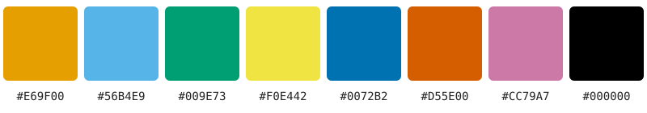

# Okabe-Ito Palette: HEX, RGB and Code for R, Python, CSS and MATLAB

The Okabe-Ito palette (also called the **Wong colorblind palette**) is the standard colorblind-safe set of eight colors for categorical scientific figures. This repository gives the exact values and ready-to-use files.



## HEX and RGB values

| Color | HEX | RGB | Contrast on white |
|---|---|---|---|
| Orange | `#E69F00` | 230, 159, 0 | 2.25:1 |
| Sky blue | `#56B4E9` | 86, 180, 233 | 2.31:1 |
| Bluish green | `#009E73` | 0, 158, 115 | 3.42:1 |
| Yellow | `#F0E442` | 240, 228, 66 | 1.32:1 |
| Blue | `#0072B2` | 0, 114, 178 | 5.19:1 |
| Vermillion | `#D55E00` | 213, 94, 0 | 3.87:1 |
| Reddish purple | `#CC79A7` | 204, 121, 167 | 3.06:1 |
| Black | `#000000` | 0, 0, 0 | 21:1 |

Contrast is the WCAG 2.x ratio against white. All values, plus HSL and contrast on black, are in [`okabe-ito.json`](okabe-ito.json).

## Which colors to use for 2 to 7 groups

Take colors in this order and stop when you have enough:

| Groups | Colors |
|---|---|
| 2 | `#E69F00` `#0072B2` |
| 3 | + `#009E73` |
| 4 | + `#D55E00` |
| 5 | + `#56B4E9` |
| 6 | + `#CC79A7` |
| 7 | + `#000000` |

Use yellow (`#F0E442`) last: at 1.32:1 against white it disappears in thin lines and small markers. Keep the same group-to-color mapping across every panel of a figure.

## Use it

**Python (matplotlib, seaborn)**: [`python/okabe_ito.py`](okabe_ito.py)

```python
okabe_ito = ["#E69F00", "#56B4E9", "#009E73", "#F0E442", "#0072B2", "#D55E00", "#CC79A7", "#000000"]

import matplotlib.pyplot as plt
plt.rcParams["axes.prop_cycle"] = plt.cycler(color=okabe_ito)

import seaborn as sns
sns.set_palette(okabe_ito)
```

**R (base R and ggplot2)**: [`r/okabe_ito.R`](okabe_ito.R)

```r
okabe_ito <- c("#E69F00", "#0072B2", "#009E73", "#D55E00", "#56B4E9", "#CC79A7", "#000000", "#F0E442")

ggplot(df, aes(x, y, colour = group)) +
  geom_point() +
  scale_colour_manual(values = okabe_ito)
```

R 4.0+ also ships the palette as `palette.colors(palette = "Okabe-Ito")`, but that version starts with black and adds gray as a ninth color, so the first group is drawn in black.

**CSS**: [`css/okabe-ito.css`](okabe-ito.css) defines `--okabe-ito-orange` and the other seven colors as custom properties.

**MATLAB**: [`matlab/okabe_ito.m`](okabe_ito.m)

```matlab
colororder(okabe_ito(4))
```

**GraphPad Prism**: create a custom color scheme and enter the HEX values from the table in the order above.

## Okabe-Ito or viridis?

Okabe-Ito is for **categories** (treatment groups, genotypes, conditions), up to eight. For **continuous** values such as heatmaps or expression intensity, use a sequential map like viridis.

## Print

Yellow fades further on paper, and sky blue loses saturation in CMYK. For print figures, outline yellow marks or replace sky blue with blue (`#0072B2`).

## More

- Full guide with HSL values, CVD simulation, and a Prism walkthrough: [Okabe-Ito palette HEX & RGB codes](https://figcanvas.com/blog/okabe-ito-palette-hex-rgb-wong-prism)
- Apply Okabe-Ito, Nature, Science or Cell palettes to a figure in one click: [Scientific color palette generator](https://figcanvas.com/tools/scientific-color-palette-generator)

## References

- Okabe M., Ito K. (2008). *Color Universal Design (CUD): How to make figures and presentations that are friendly to colorblind people.* https://jfly.uni-koeln.de/color/
- Wong B. (2011). Points of view: Color blindness. *Nature Methods* 8(6):441. https://doi.org/10.1038/nmeth.1618

## License

Code: MIT. The palette itself is from Okabe and Ito (2008).
